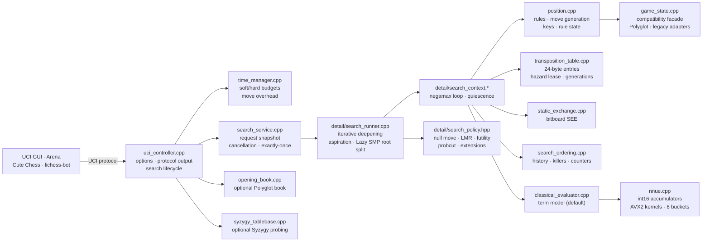

# System architecture

This page maps Koi's runtime modules to the files under `src/koi`. It is a
module map, not a call graph: solid arrows show the main data and control
direction, and every node names a real translation unit or header.

## Components

| File | Responsibility |
| --- | --- |
| `uci_controller.cpp` | Owns the current position and the search-worker lifecycle; the only layer that writes UCI output. |
| `search_service.cpp` | Public search lifecycle boundary: request snapshot, cancellation, exactly-once completion. |
| `detail/search_runner.cpp` | Backend dispatch, iterative deepening, aspiration windows, Lazy SMP and root-parallel scheduling. |
| `detail/search_context.*` | Search-local recursive state: move loop, quiescence, pruning call sites, fixed-capacity stack. |
| `detail/search_policy.hpp` | Centralized scalar gates: null move, late-move reductions, futility, probcut, check extensions. |
| `position.cpp` | Production authority for legality, position keys, rule state, and move generation. |
| `game_state.cpp` | Compatibility facade used by the evaluator, search, and UCI APIs; keeps its private mirror synchronized. |
| `transposition_table.cpp` | Physical storage, locking, generations, clearing, resizing, and mate-score normalization. |
| `static_exchange.cpp` | Bitboard static-exchange evaluation used by pruning and ordering. |
| `search_ordering.cpp` | History, killers, and continuation counters for move ordering. |
| `classical_evaluator.cpp` | Default evaluator: material and positional term model. |
| `nnue.cpp` | Optional Koi-native NNUE: integer forward pass, AVX2 kernels, king-bucket features. |
| `opening_book.cpp` | Optional Polyglot opening book; no book is bundled. |
| `syzygy_tablebase.cpp` | Optional Syzygy root and interior probing; no tablebase data is bundled. |
| `time_manager.cpp` | Soft/hard time budgets, move-overhead subtraction, and flag-proof ceilings. |

## Optional layers

- `src/koi/gpu/` — CUDA NNUE inference; optional, with the CPU evaluator as
  fallback.
- `src/koi/modules/` — the optional C++26 named-module partitions (`types`,
  `position`, `eval`, `tablebase`, `search`, `runtime`).
- `src/koi/detail/` — private implementation headers and units that do not
  establish a public ABI.

## Data flow

1. The UCI controller validates a `position`/`go` pair and starts a search
   session.
2. The search service snapshots the request and hands it to the runner.
3. The runner drives iterative deepening over the shared transposition table
   and, with `Threads > 1`, over Lazy SMP workers.
4. Every node evaluates through the classical evaluator or a loaded NNUE
   network, and orders moves through the shared ordering tables.
5. Completed root iterations are published back through the UCI controller,
   which is the only component that writes protocol output.
