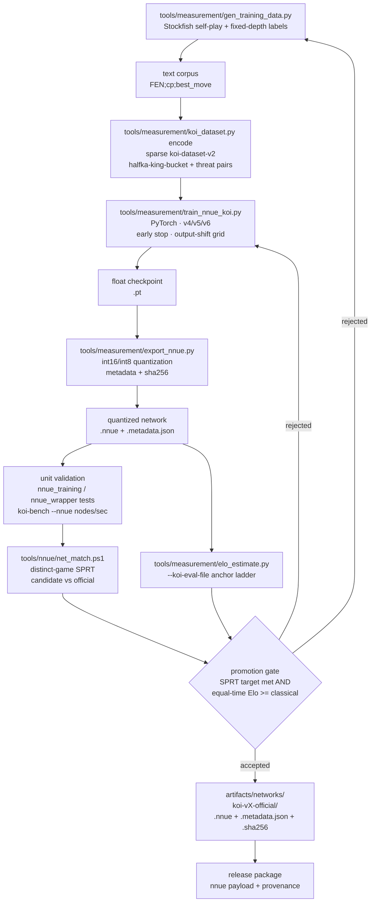

# NNUE training and promotion loop

Koi's evaluator is optional but first-class: the release packages ship a gated
network. This page shows the loop that turns self-play data into a promoted
`.nnue` file, with the exact tools in this repository.

## Stages

| Stage | Tool | Output |
| --- | --- | --- |
| Data generation | `tools/measurement/gen_training_data.py` | Text corpus (`FEN;cp;best_move`). |
| Corpus encoding | `tools/measurement/koi_dataset.py encode` | Sparse `koi-dataset-v2` binary. |
| Training | `tools/measurement/train_nnue_koi.py` | Float checkpoint (`.pt`) plus training metadata. |
| Quantization | `tools/measurement/export_nnue.py` | `int16/int8` `.nnue` file and metadata JSON. |
| Unit validation | `tests/python/evaluation/*`, `koi-bench --nnue` | Fast parity and throughput checks. |
| Relative gate | `tools/nnue/net_match.ps1` | Distinct-game SPRT report. |
| Absolute gate | `tools/measurement/elo_estimate.py --koi-eval-file` | Anchor-ladder Elo estimate. |
| Promotion | `artifacts/networks/koi-vX-official/` | Network, metadata, checksum. |

## Promotion rules

- A network is promoted only when the relative SPRT accepts **and** the
  absolute estimate shows it at least matches the classical evaluator at equal
  time. A network that is weaker is rejected even if it is faster.
- Evidence is hash-tied: the report records the network SHA-256, engine
  executable, options, openings, and time control.
- The official network directory carries the `.nnue`, its metadata, and a
  `.sha256` sidecar; release packages copy that payload with provenance.
- Training changes are one variable at a time (architecture, data size, or
  shift grid), so a rejected run points at a single cause.
